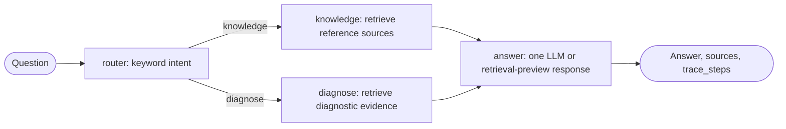

# OpsPilot — 7-day Codex build kit

This is an **educational, enterprise-style project**, not a production service.
The starter provides a small FastAPI app, a 3-step LangGraph workflow,
BM25 RAG with source URLs, local SQLite incident drafts/tickets,
and an MCP v2 server/client integration. It does **not** yet provide A2A;
Day 5 in `PROMPTS.md` implements the real A2A protocol using the official SDK.

## What is real and what is simulated?

- Real: Python code, LangGraph graph, OpenRouter request, web document ingestion,
  official MCP protocol tool server/client, SQLite persistence, tests.
- Simulated: enterprise service-desk tickets, approval authentication via a local demo code,
  incident logs. Do not describe these as production identity or ServiceNow integration.
- Day 2 upgrades the starter corpus: bundled entries are short paraphrased summaries with source
  links, *not* the full text of the live websites. Run the ingestion script to fetch current text.
- Day 5 adds one independently running A2A diagnosis agent.

## Prerequisites

Python 3.11+; Internet to install packages, download docs and use OpenRouter;
Codex CLI or Codex IDE extension. An OpenRouter key and a valid current model ID
are needed for generated answers. Retrieval preview and ticket demo work without an LLM key.

## Start on your laptop

```bash
python -m venv .venv
# macOS/Linux:
source .venv/bin/activate
# Windows PowerShell:
# .venv\Scripts\Activate.ps1
python -m pip install -r requirements.txt
cp .env.example .env  # Windows PowerShell: Copy-Item .env.example .env
# Edit .env: put OPENROUTER_API_KEY, OPENROUTER_MODEL, DEMO_APPROVAL_CODE.
python -m pytest -q
```

**Run the API (terminal 1):**

```bash
python -m uvicorn app.api:app --reload --port 8000
```

**Run the real MCP tool server (terminal 2):**

```bash
python -m app.mcp_server
```

**On Day 2, cache and chunk exactly three official Kubernetes docs** (replaces the seed summary corpus):

```bash
python scripts/ingest_docs.py
```

Use `python scripts/ingest_docs.py --refresh` to download them again. HTML is
cached in ignored `data/cache/`, so the normal command can run without network
after the first successful fetch. Each saved chunk contains a title, source URL,
UTC retrieval date, chunk ID, and text. Empty, short, or mostly non-letter
pages are rejected and the corpus is written only after all three pages succeed.

## Retrieval trade-offs

BM25 is still word-based retrieval, but it ranks rare matching words and uses
term frequency and chunk length instead of merely counting unique overlap. It
is small enough to inspect and needs no retrieval framework or model service.
It cannot match concepts expressed with different words, so a vector or hybrid
retriever would be a later improvement.

Chunks are 1,000 characters with a 150-character overlap. The overlap keeps a
sentence near a chunk boundary from losing all its context. Smaller chunks can
be more precise but omit context; larger chunks give more context but can make
the model read unrelated material. Every non-empty retrieved answer appends
the exact source URLs used. A question with no matching chunks has no source to
cite and returns the existing no-documentation message.

## Demo commands

## Day 3 workflow routing



`router` checks a small fixed list of operational keywords. `knowledge` retrieves
documentation for general questions. `diagnose` retrieves evidence and records
whether it found material for a diagnosis. Both paths meet once at `answer`,
which is the only workflow node that calls the LLM module. There is no agent
loop: each request makes exactly one routing choice. `trace_steps` in `/chat`
shows the nodes that ran, for example `router:diagnose`,
`diagnose:retrieved_evidence`, and `answer:completed`.

### 1. Health

```bash
curl http://127.0.0.1:8000/health
```

### 2. Ask the graph (key optional; without key the answer is labelled a retrieval preview)

```bash
curl -X POST http://127.0.0.1:8000/chat \
  -H 'Content-Type: application/json' \
  -d '{"question":"Why is my Kubernetes pod OOMKilled and restarting?"}'
```

### 3. Prepare ticket (no ticket created yet)

```bash
curl -X POST http://127.0.0.1:8000/tickets/drafts \
  -H 'Content-Type: application/json' \
  -d '{"title":"Kubernetes OOMKilled","summary":"Pod restarts; investigate memory limit."}'
```

Copy the resulting `draft_id` and substitute it below. Keep the MCP server running.

### 4. Approve it (calls the ticket tool over MCP)

```bash
curl -X POST 'http://127.0.0.1:8000/tickets/drafts/PASTE_DRAFT_ID/approve' \
  -H 'Content-Type: application/json' \
  -d '{"approval_code":"YOUR_DEMO_APPROVAL_CODE"}'
curl http://127.0.0.1:8000/tickets
```

Without a valid approval code, FastAPI returns HTTP 403. Without a running MCP
server, ticket creation returns HTTP 503 and the approved draft can be retried.
Calling the same approval twice should not create duplicate tickets.

## Files worth understanding

| File | One job |
| --- | --- |
| `app/api.py` | Receive requests and return responses |
| `app/workflow.py` | Define LangGraph nodes and execution order |
| `app/knowledge.py` | Retrieve passages and source URLs |
| `app/llm.py` | Make one OpenRouter chat-completion request |
| `app/tickets.py` | Persist drafts and approved tickets in SQLite |
| `app/mcp_server.py` | Expose two tools using actual MCP protocol |
| `app/mcp_client.py` | Invoke the MCP server over Streamable HTTP |
| `scripts/ingest_docs.py` | Download public docs for RAG |
| `tests/` | Explainable safety and smoke tests |
| `PROMPTS.md` | One Codex prompt per day |

## Known MVP limitations (say this in the interview)

- BM25 retrieval is word based, not embeddings/hybrid/vector search.
- Ticket approval uses a demo code, not Entra ID or real authorization.
- The LangGraph graph currently classifies but does not route differently by intent.
  Extend with conditional edges during Day 3.
- The starter is not yet fully wired to A2A; use the official A2A Python SDK on Day 5.
- No production-grade auth, telemetry, centralized logging or deployed scaling yet.
- Published docs must be reviewed for usage rights, accuracy and change over time.
- Run and verify MCP API details with installed SDK version; code was syntax checked
  but its external SDK dependencies could not be installed in the build environment.
