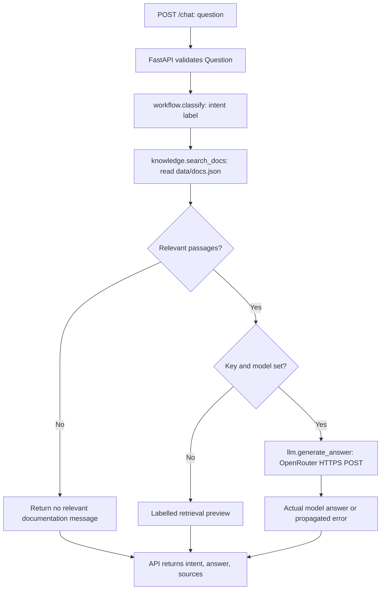
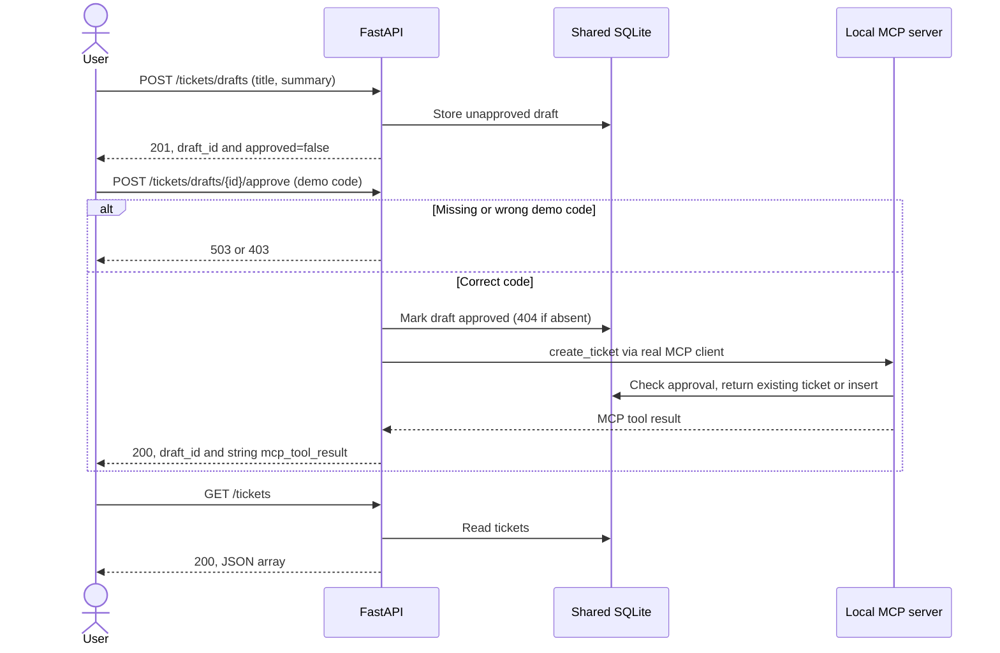
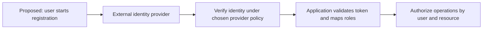

# Operational flows

## Chat: implemented

Classification does not branch the graph. `/chat` never creates a ticket or invokes MCP. An upstream OpenRouter exception currently becomes HTTP 500, rather than a successful response with a fabricated answer.

## Tickets: implemented local demo

If MCP is unavailable, approval returns 503 and the draft stays approved. Retry after restoring MCP. The code verifies sequential retry idempotency; it does not guarantee every concurrent request succeeds.

| Operation | Input | Output / failure | Storage effect |
| --- | --- | --- | --- |
| `GET /health` | None | 200 status and service | None |
| `POST /chat` | Question, 3–2000 characters | 200 intent/answer/sources; 422 invalid input; upstream errors may become 500 | None |
| `POST /tickets/drafts` | Title 3–150, summary 3–2000 characters | 201 draft ID and false approval; 422 invalid input | Inserts draft |
| `POST /tickets/drafts/{id}/approve` | Approval code string | 200 result; 403 wrong code; 404 missing draft; 503 missing code or MCP failure | Approves draft; MCP may insert ticket |
| `GET /tickets` | None | 200 array, possibly empty | Creates schema if needed, then reads |

## User registration: not implemented

There is no registration endpoint, users table, password handling, session, or identity-provider integration. The demo approval code does not register or identify a user. The following is a proposed process only; it requires a separate feature request and ADR before implementation.

| Proposed stage | Decision still needed | Current implementation |
| --- | --- | --- |
| Register / sign in | Identity provider and OIDC flow | Absent |
| Establish identity | Token validation, session lifetime | Absent |
| Authorize access | Ownership and role policy | Shared local demo approval code only |
| Audit actions | Retention and privacy policy | No production audit system |

## Development and deployment

The repository has no CI workflow, container definition, or deployment configuration. The local development routine below is executable; automated CI/CD remains a proposal.

| Stage | Current local command / action | Automation status |
| --- | --- | --- |
| Install | `python -m venv .venv`, then `.venv/bin/python -m pip install -r requirements.txt` | Manual; dependencies have version ranges, no lockfile |
| Validate | `.venv/bin/python -m pip check` and `.venv/bin/python -m pytest -q` | Manual; 6 tests passed |
| Start | API and MCP commands in [entrypoint.md](entrypoint.md) | Manual, two processes |
| Smoke check | Health, retrieval preview, MCP discovery, approved ticket retry | Manual; verified locally |
| Publish code | Commit reviewed files and push a branch | Git operation, not application deployment |
| Deploy | Choose target, packaging, secrets, database persistence, authentication and rollback | Not configured |

An OpenRouter smoke request is manual and needs credentials/network permission. Never add credentials to source control or assume that offline tests validate model availability.
